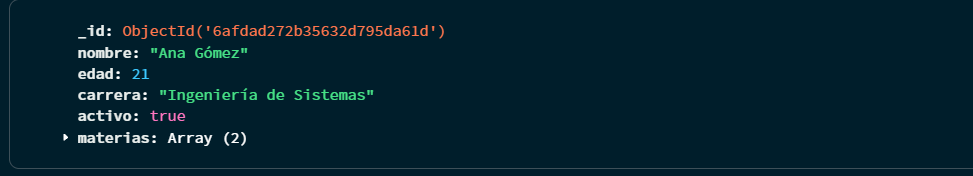
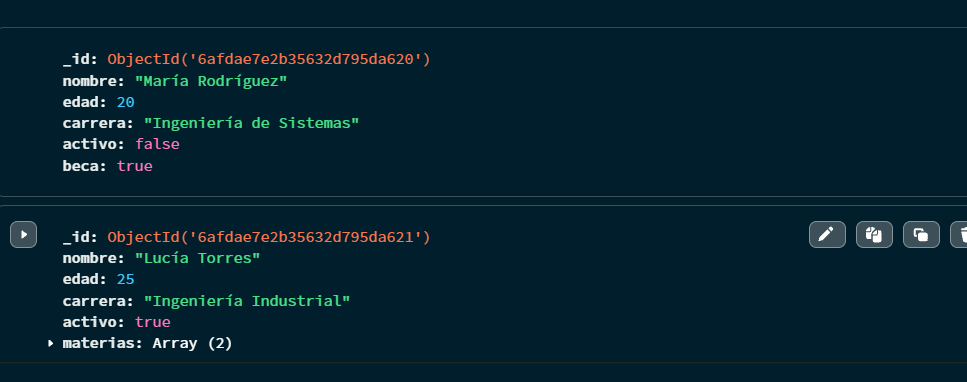
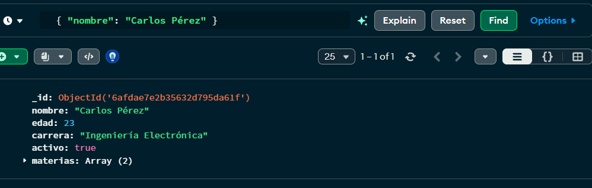
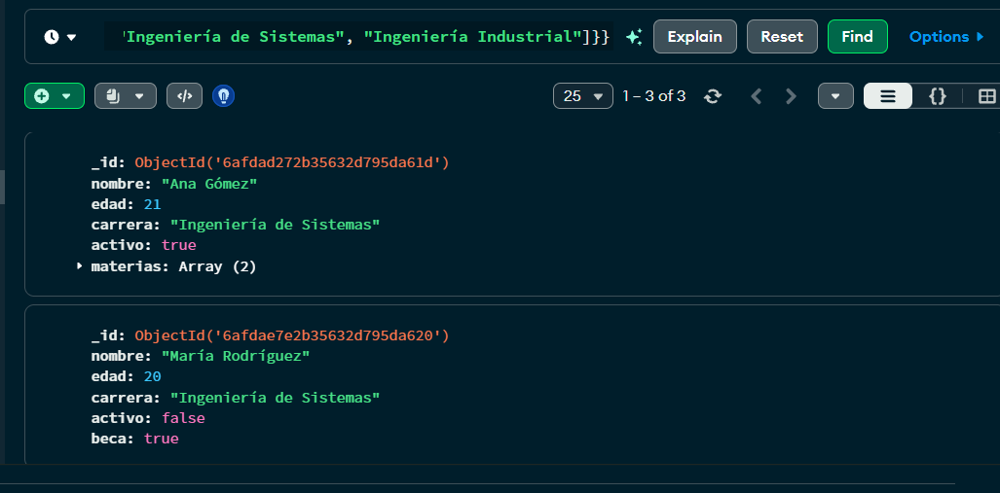
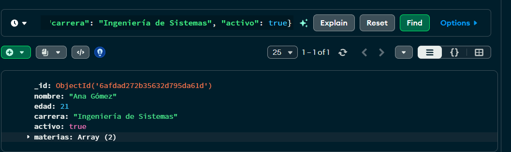
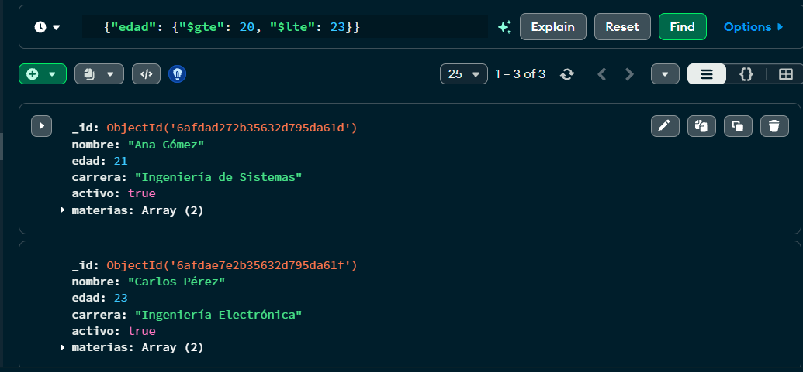

Insertar un dato:

{
  "nombre": "Ana Gómez",
  "edad": 21,
  "carrera": "Ingeniería de Sistemas",
  "activo": true,
  "materias": [
    "Bases de Datos",
    "Lógica Computacional"
  ]
}

Insertar Varios datos:

[
  {
    "nombre": "Carlos Pérez",
    "edad": 23,
    "carrera": "Ingeniería Electrónica",
    "activo": true,
    "materias": ["Arquitectura de Computadores", "Física"]
  },
  {
    "nombre": "María Rodríguez",
    "edad": 20,
    "carrera": "Ingeniería de Sistemas",
    "activo": false,
    "beca": true
  },
  {
    "nombre": "Lucía Torres",
    "edad": 25,
    "carrera": "Ingeniería Industrial",
    "activo": true,
    "materias": ["Investigación de Operaciones", "Cálculo"]
  }
]

Consultas basicas inciales:

{ "nombre": "Carlos Pérez" }

Buscar por carrera usando $in:

{"carrera": {"$in": ["Ingeniería de Sistemas", "Ingeniería Industrial"]}}

Buscar usando $and (por ejemplo: carrera y estado activo)

{"carrera": "Ingeniería de Sistemas", "activo": true}

Buscar usando rangos ($gte y $lte)

{"edad": {"$gte": 20, "$lte": 23}}

